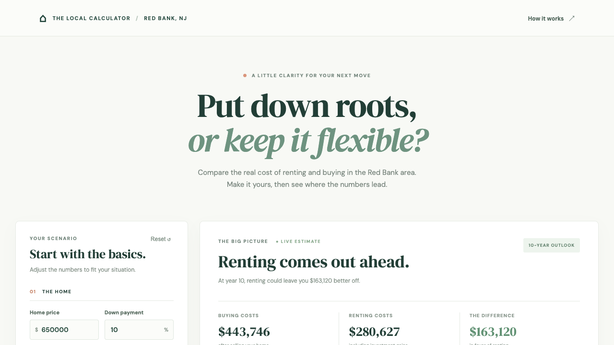
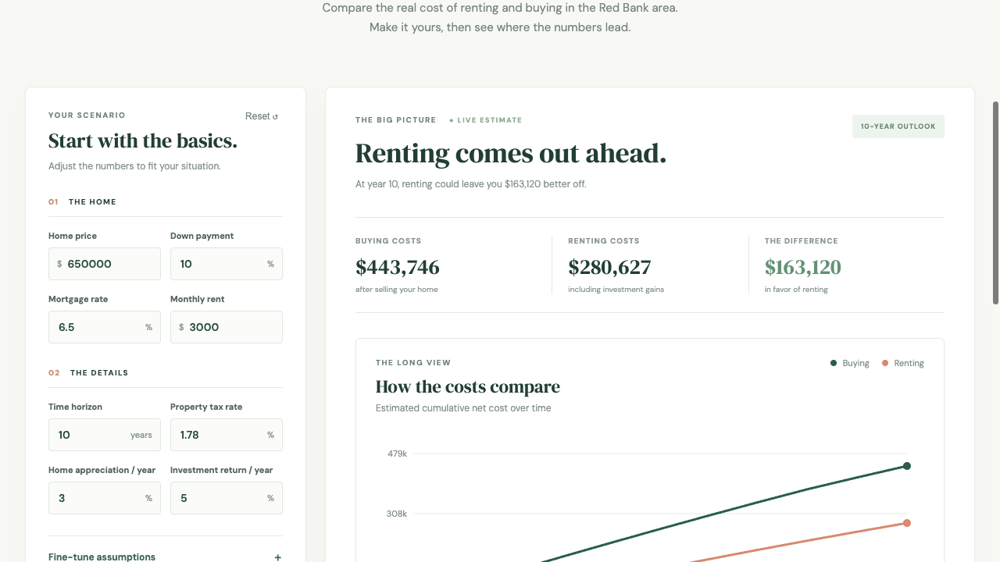

# The Local Calculator: Rent vs. Buy

A client-side rent versus buy calculator with Red Bank, New Jersey starting assumptions. Open `index.html` in a modern browser, or serve the directory with `python3 -m http.server 8000`. No account, build step, or data collection is required.

## Screenshots

All inputs are editable. The 1.78% default property tax rate is the [2025 Red Bank effective rate](https://www.nj.gov/treasury/taxation/taxamnesty/treasury/taxation/pdf/lpt/gtr/2025taxrates.pdf), used as an estimate of tax relative to market value, not the rate applied to a specific assessment. Other defaults are illustrative, not quotes.

## Model

The calculator compares accumulated buying cash outflows less net sale proceeds with rent outflows adjusted for investment returns. The renter's investment account starts with the buyer's down payment and closing costs; each month the difference in housing costs is added to or withdrawn from it. A negative account balance is treated as borrowing at the assumed investment return. Buying includes principal and interest, estimated PMI, taxes, insurance, maintenance, HOA, and purchase and sale costs. Home value and recurring expenses grow annually. PMI is modeled until the mortgage reaches 80% of the original price; real-world cancellation depends on loan terms and servicer rules. Break-even is the first year-end at which sale proceeds exceed the renter's investment account, and is not necessarily permanent. Tax deductions, income taxes, deposits, and moving costs are excluded. Results are estimates, not financial advice.

Run model checks with `node test.js`.
